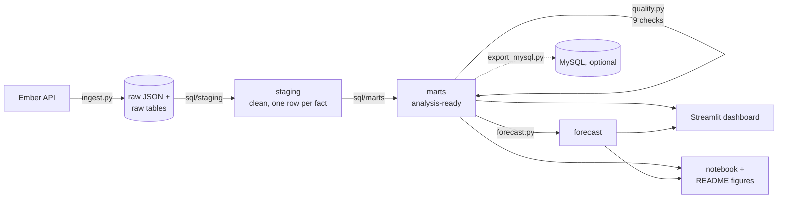
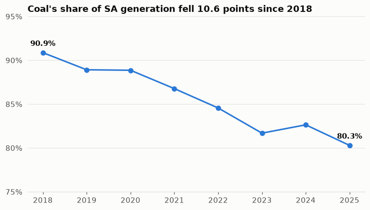
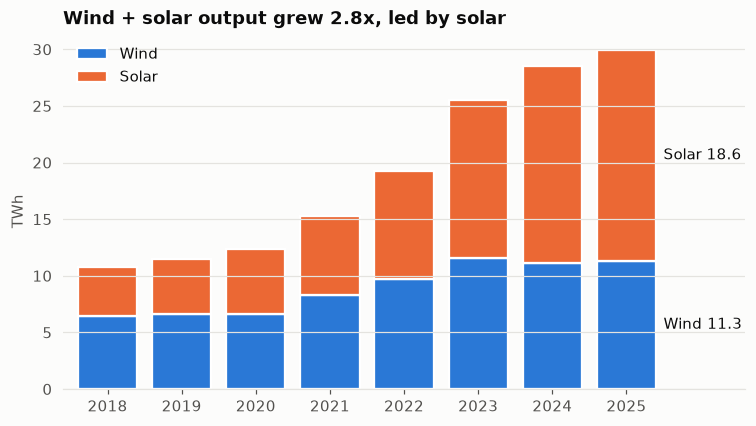
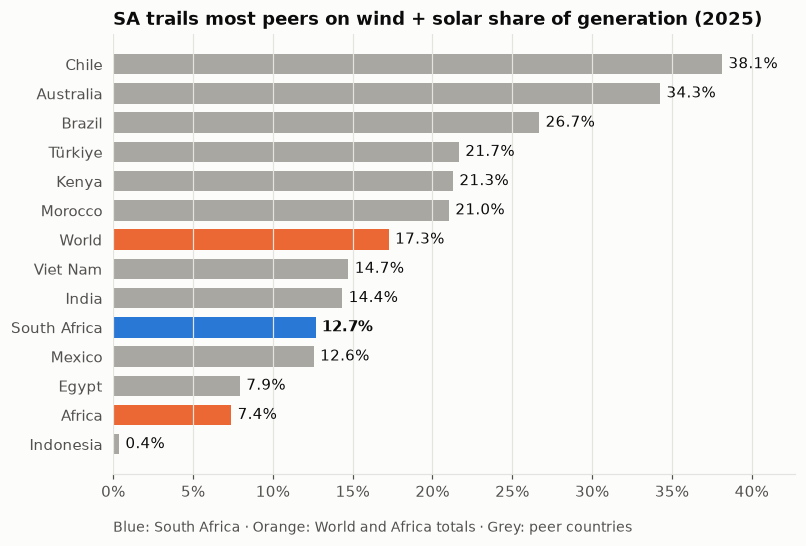
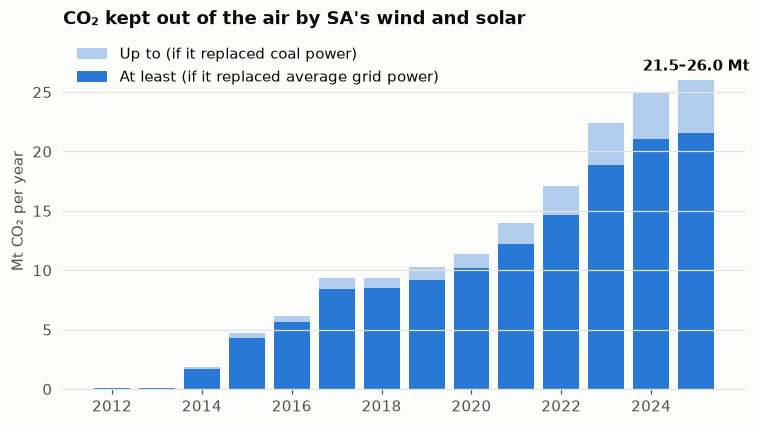
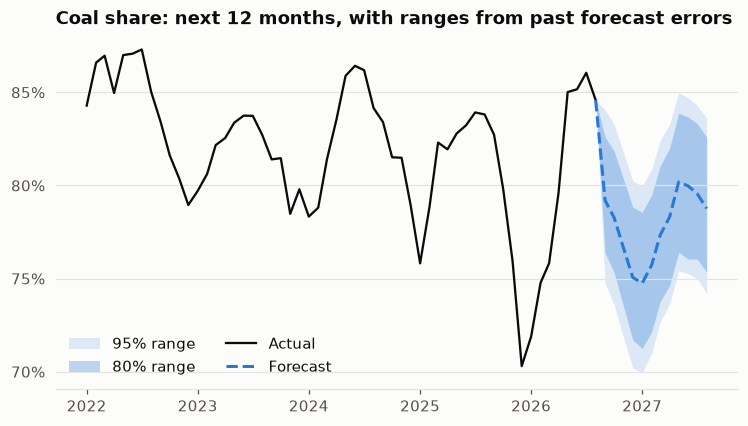

# grid-pulse ⚡ How fast is South Africa getting off coal?

An end-to-end data analysis of South Africa's electricity grid: from raw API data to a tested SQL warehouse,
a peer comparison across 14 countries and regions, a CO₂ counterfactual, a backtested forecast and an animated dashboard.

**Status:** Ember analysis complete (data through Aug 2026). Eskom hourly data has been requested for the next phase.

## Why I built this

South Africa's electricity crisis is one of the country's biggest economic problems: years of load-shedding,
and a grid that still runs mostly on coal. I wanted a portfolio project that tackles a real problem end to end,
the way an analyst would at work:

- **Start from a question, not a dataset:** *how fast is South Africa getting off coal, and is that fast enough?*
- **Own the whole pipeline:** pull data from an API, model it in SQL, validate it, analyse it, forecast it and present it.
- **Be honest about uncertainty:** ranges instead of single numbers, a simple baseline for every model, and limitations stated up front.

It's also a learning project. I used it to practise SQL data modelling, data-quality testing, backtesting and
dashboard design, and it builds on related work I've done in the energy space.

---

## TL;DR

- **Coal still makes about 80% of SA's electricity**, down from 91% in 2018. It's falling at roughly **1–1.5 points a year**.
- **SA is falling behind its peers.** Wind + solar provide **12.7%** of generation. That ranks **9th of 12** comparable countries and is below the world average (17.3%). Since 2015, Kenya and Vietnam have overtaken SA.
- **Its renewables already pay off.** Wind and solar kept an estimated **21.5–26.0 Mt of CO₂** out of the air in 2025, about what **5 million cars** emit in a year.
- **Month to month, coal's share is mostly noise.** The best of four forecasting models is only 3% more accurate than "same month last year". At the current pace, coal falls below 70% somewhere between **2034 and 2041**.

## The question

South Africa has one of the most coal-dependent grids in the world and a decade of load-shedding behind it.
Renewables are growing, but **is the shift fast, and how does it compare with countries in a similar position?**

I broke that into five questions, each answered with data in this repo:

1. How fast is coal's share falling, and what's replacing it?
2. How does SA compare with sunny, coal-heavy or emerging peers?
3. What has the shift actually achieved in CO₂ terms?
4. Can we forecast coal's share over the next year, and how reliable is that forecast?
5. At the current pace, when could coal fall below 70%?

## Data

| Source | What | Used for |
|---|---|---|
| [Ember electricity data API](https://ember-energy.org/data/api/) (monthly) | SA generation by fuel and demand, Jan 2018 – Aug 2026 | Power mix, 12-month forecast |
| Ember API (yearly) | Generation, emissions and carbon intensity for 12 countries plus the World and Africa, 2000–2025 | Peer comparison, CO₂ analysis, 70% scenario |
| [Eskom Data Portal](https://www.eskom.co.za/dataportal/) | Hourly demand, capacity, outages | *Next phase (requested)* |

**Peers:** Chile, Brazil, Morocco, Egypt, Kenya, India, Vietnam, Indonesia, Australia, Mexico and Türkiye.
They were chosen for being sunny, coal-heavy or emerging economies like South Africa's.

## Approach



- **Warehouse:** DuckDB, with raw → staging → marts layers written in plain SQL ([`sql/`](sql/)).
- **Data-quality gates:** 9 checks run on every build. They confirm that fuels add up to Ember's own totals, that generation + net imports = demand, that no months or years are missing, and that emission rates are physically plausible. The build fails if any check fails.
- **Tests:** 13 pytest tests. They include tests that feed in deliberately broken data (a demand mismatch, a missing month, emissions loaded in kilotonnes instead of megatonnes) to prove the checks catch it.

## Findings

### 1. Coal is falling, but slowly

Coal's share of SA's generation fell from **90.9% (2018) to 80.3% (2025)**. That's about 1.5 points a year on Ember's monthly data.
Total domestic generation **bottomed out in 2023 (225 TWh, −12% vs 2018)**, the worst load-shedding year, then partly recovered.



### 2. Solar is the growth story

Utility-scale solar went up **4.3x** (4.3 → 18.6 TWh, 2018–2025) and wind went up 1.8x. Together they now provide about 13% of generation.



### 3. SA is falling behind its peers

| | Wind + solar share, 2025 | Change since 2015 |
|---|---:|---:|
| Chile | 38.1% | +33.7 pts |
| Australia | 34.3% | +27.2 pts |
| Brazil | 26.7% | +23.0 pts |
| Kenya | 21.3% | +20.2 pts |
| **World** | **17.3%** | **+12.8 pts** |
| **South Africa** | **12.7%** | **+10.5 pts** |
| Africa | 7.4% | +5.9 pts |

SA's share grew **more slowly than the world average** over the decade. It ranked 8th of 12 peers in 2015 and 9th in 2025: Kenya and Vietnam overtook it, and it passed only Mexico.



### 4. One of the dirtiest grids, but renewables are already paying off

SA's grid emits **699 g CO₂ per kWh, 1.5x the world average** (460). Of the 12 peers, only Indonesia's is higher.

**How much CO₂ did wind and solar avoid?** I estimated what emissions would have been if that electricity had come from other plants, using two assumptions to bracket the answer:

- **Low:** it replaced *average grid power* (at that year's grid carbon intensity).
- **High:** it replaced *coal power* (at that year's coal emission rate, about 0.85 kg/kWh). This is a reasonable upper bound for SA, where coal supplies most of the power that wind and solar could displace.

**Result:** **21.5–26.0 Mt CO₂ avoided in 2025** and **137–158 Mt since 2000**. Without wind and solar, SA's grid would have run at about **806 g/kWh instead of 699**.
For scale, 2025's saving is about what 4.7–5.7 million cars emit in a year (US EPA: 4.6 t CO₂ per typical car per year).
Each step of the calculation is in [`fct_co2_avoided_yearly.sql`](sql/marts/fct_co2_avoided_yearly.sql).



### 5. Forecasting: the honest result is that the short run is mostly noise

I compared four models for the monthly coal share by **rolling-origin backtesting**. From Dec 2021 onward I stood at each month, let every model see only the data up to that point, and scored its next-12-month forecast against what actually happened.

| Model | Average error, 1–12 months ahead |
|---|---:|
| **Linear trend + month-of-year effects** | **2.41 pts** |
| Same month last year (seasonal naive) | 2.49 pts |
| Trend + season, last 4 years only | 2.56 pts |
| Drift (straight line from first to last value) | 3.80 pts |

The best model is **only 3% better than the naive baseline**. One month ahead, simply repeating last month's value wins (1.6 pts).
Month to month, SA's coal share is driven mostly by **plant breakdowns, weather and demand swings**, not by a smooth trend.
The forecast ranges come from the model's **own past errors**, so they show how wrong it has really been rather than a textbook formula.

**Next 12 months:** coal's share averages about **77.8%** (80% range: 74–82%).



### 6. When could coal fall below 70%?

Too far ahead for a monthly model, so this is a **scenario, not a forecast**. I fitted straight-line trends to annual coal share over three windows:

| Trend fitted since | Slope | Coal reaches 70% |
|---|---:|---:|
| 2018 | −1.30 pts/yr | ~2034 |
| 2021 | −0.99 pts/yr | ~2037 |
| 2010 | −0.78 pts/yr | ~2041 |

The seven-year spread shows how much the answer depends on which years you trust.

## Data validation: Ember's two datasets disagree

While writing this up I found that **Ember's yearly and monthly datasets give different numbers for SA**. The difference is mostly in coal, and it has grown since 2022:

| Year | Coal, monthly data summed | Coal, yearly data | Difference |
|---|---:|---:|---:|
| 2022 | 198.6 TWh | 201.8 TWh | +3.2 |
| 2023 | 183.4 TWh | 192.3 TWh | +8.9 |
| 2024 | 194.9 TWh | 206.8 TWh | +12.0 |
| 2025 | 185.5 TWh | 197.5 TWh | +12.0 |

The two datasets appear to be built from different underlying sources, and I can't confirm from the data alone which is more complete.
**How I handled it:** every analysis uses one dataset consistently.
The monthly data drives the power-mix and forecast sections, and the yearly data drives the peer, CO₂ and 70% sections.
That's why SA's 2025 coal share reads **80.3% (monthly) in some places and 81.4% (yearly) in others.**

## So what?

- **To reach the world-average share** (17.3%) at today's generation, SA needs about **42 TWh** of wind + solar a year, **+36%** on 2025's 30.8 TWh.
- **To match Chile** (38%), it would need about **3x** today's output.
- **At the current pace, coal still produces most of SA's power well into the 2030s.** Closing the gap with its peers would take a clear acceleration in new wind and solar, not more of the same.

## Limitations

- **Utility data only.** Rooftop solar is largely invisible in grid statistics, so the real shift away from coal is probably somewhat larger than shown here.
- **The CO₂ counterfactual** doesn't model second-order effects, such as backup plants running less efficiently when wind and solar output varies.
- **Model selection and the forecast ranges come from the same backtest,** so the ranges are slightly optimistic.
- **The peer set is my choice.** A different set would give a different rank. To change it, edit `PEER_CODES` in [`ingest.py`](src/grid_pulse/ingest.py).

## Dashboard

`streamlit run streamlit_app.py` opens an interactive dashboard with three pages:

- **⚡ Power mix:** KPIs, a year filter, and an **animated month-by-month replay** of the generation mix.
- **🌍 SA vs. the world:** an **animated race chart** of wind + solar share for 14 countries and regions from 2000 to 2025, plus carbon intensity and CO₂ avoided.
- **📈 Forecast:** the 12-month forecast with ranges, plus an **animated backtest replay** that shows what the model predicted at each point in time against what actually happened.

All charts have hover tooltips and follow Streamlit's light/dark theme. The colors were checked for colorblind readability.

## How to run

```bash
python -m venv .venv
.venv\Scripts\activate           # Windows  (source .venv/bin/activate on macOS/Linux)
pip install -e ".[dev]"
copy .env.example .env           # then paste a free Ember API key: https://ember-energy.org/data/api/

python -m grid_pulse.ingest      # Ember API -> data/raw -> raw.* tables
python -m grid_pulse.transform   # raw -> staging -> marts, then the 9 data-quality checks
python -m grid_pulse.forecast    # backtest, 12-month forecast, 70% scenarios
python -m grid_pulse.figures     # README figures 04-06
pytest                           # 13 tests

streamlit run streamlit_app.py   # dashboard at http://localhost:8501
```

**Optional: explore in MySQL.** Set the `MYSQL_*` values in `.env` and run `python -m grid_pulse.export_mysql`.
It copies every staging, mart and forecast table into a `grid_pulse` database for browsing in MySQL Workbench.

## Project structure

```
grid-pulse/
├── sql/
│   ├── staging/            # cleaning: one row per month/year per fuel, aggregates dropped
│   └── marts/              # analysis tables: power mix, peer transition, CO₂ avoided
├── src/grid_pulse/
│   ├── ember.py            # Ember API client
│   ├── ingest.py           # API -> raw JSON -> DuckDB
│   ├── transform.py        # builds staging + marts from sql/
│   ├── quality.py          # data-quality checks
│   ├── forecast.py         # models, backtest, scenarios (numpy)
│   ├── figures.py          # static README figures
│   ├── replay.py           # animated chart component
│   ├── dash.py, charts.py  # shared dashboard and chart styling
│   └── export_mysql.py     # optional MySQL copy
├── app_pages/              # Streamlit pages
├── notebooks/              # exploratory analysis
├── reports/figures/        # charts used in this README
└── tests/
```

## Technical decisions

- **DuckDB instead of a database server.** The whole warehouse is a single file, so anyone who clones the repo can run it without installing or configuring a server. MySQL is supported as an optional copy.
- **No pandas.** It's blocked on my development machine by Windows Application Control, so the project uses SQL for data work, numpy for modelling and Altair/Vega for charts. The constraint kept the code lean: most of the data work happens in SQL.
- **Tests built from data with known answers.** For example, the forecast test builds a series with a known trend and seasonal pattern and checks that the model recovers it exactly.

## What's next

- [ ] **Eskom hourly data:** how many hours demand exceeded available capacity, seasonal patterns in unplanned outages, and the daily "duck curve" (the midday dip in demand on the grid) as solar grows
- [ ] Hourly demand forecasting on the Eskom data
- [ ] GitHub Actions: tests on every push and a monthly data refresh
- [ ] Deploy the dashboard to Streamlit Community Cloud

## Sources

- Ember, *Electricity data API* (monthly and yearly generation, demand, emissions, carbon intensity). https://ember-energy.org/data/api/
- US EPA, *Greenhouse Gas Emissions from a Typical Passenger Vehicle* (4.6 t CO₂ per year).
- Eskom Data Portal. https://www.eskom.co.za/dataportal/
