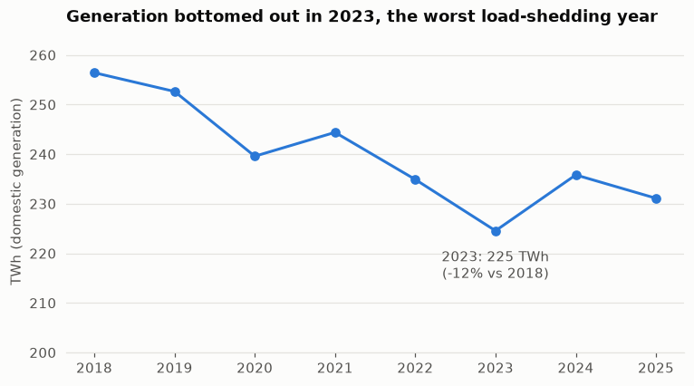

# grid-pulse ⚡

Analysis of South Africa's electricity grid: demand vs. available capacity, unplanned outages,
the coal-to-renewables shift, and short-term demand forecasting.

> 🚧 Work in progress, built as a learning project.

## Data sources

| Source | Granularity | How it's loaded |
|---|---|---|
| [Ember API](https://ember-energy.org/data/api/) | Monthly generation by fuel, demand | `python -m grid_pulse.ingest` (automated) |
| [Eskom Data Portal](https://www.eskom.co.za/dataportal/) | Hourly demand, capacity, outages, renewables | Bulk CSVs via the data request form → `data/raw/eskom/` |

## Quickstart

```bash
python -m venv .venv
.venv\Scripts\activate          # Windows  (source .venv/bin/activate on macOS/Linux)
pip install -e ".[dev]"
copy .env.example .env          # then paste your Ember API key
python -m grid_pulse.ingest      # API -> data/raw -> raw.* tables
python -m grid_pulse.transform   # raw -> staging -> marts, then data-quality checks
python -m grid_pulse.forecast    # backtested coal-share forecast + 70% scenarios
pytest
```

**Dashboard:** `streamlit run streamlit_app.py` opens an interactive dashboard at http://localhost:8501.
It has two pages:
- **Power mix:** a year filter, KPIs, an animated month-by-month replay and hover tooltips on every chart.
- **SA vs. the world:** an animated race chart of wind + solar share across 14 countries and regions, grid carbon intensity, and how much CO₂ SA's wind and solar avoided.
- **Forecast:** a 12-month coal-share forecast with ranges taken from past errors, an animated replay of the backtest, model errors by forecast distance, and the when-below-70% scenarios.

**Optional: explore in MySQL.** DuckDB (`data/grid.duckdb`) is the project's database and needs no server.
To browse the results in MySQL Workbench, set the `MYSQL_*` values in `.env` and run
`python -m grid_pulse.export_mysql`. That copies the staging and mart tables into a `grid_pulse` database.

## Roadmap

- [x] Project setup
- [x] Ember ingestion → DuckDB
- [x] Peer comparison: SA vs. 11 countries + World/Africa, 2000–2025
- [x] CO₂-avoided estimate with high/low assumptions
- [ ] Eskom hourly CSV loader
- [x] Clean / tidy SQL models + data-quality tests
- [x] Notebook 01: power mix 2018–2025
- [ ] Notebook 02: Eskom hourly demand vs. capacity, outages
- [x] Coal-share forecast: 4 models compared by rolling-origin backtest, with ranges from past errors
- [x] Streamlit dashboard with animated month-by-month replay
- [ ] GitHub Actions scheduled refresh

## Key findings so far

From [notebook 01](notebooks/01_power_mix.ipynb) (Ember monthly data, full years 2018–2025):

1. **Coal is losing share steadily, but slowly:** from 90.9% of generation in 2018 to 80.3% in 2025.
2. **Solar is the growth story:** utility-scale solar went up 4.3x (4.3 → 18.6 TWh); wind + solar now provide ≈13% of generation.
3. **2023 was the low point:** domestic generation fell 12% from 2018, then partly recovered in 2024.

### South Africa vs. the world (Ember yearly data, 2025)

4. **SA is falling behind its peers.** Wind + solar provide 12.7% of SA's generation. That ranks 9th of 12 peer countries and is 4.6 points below the world average (17.3%). Chile (38%), Australia (34%), Brazil (27%), Kenya and Morocco (21%) are all well ahead.
5. **SA has one of the dirtiest grids in the group:** 699 g CO₂/kWh, 1.5x the world average (460). Only Indonesia's is higher.
6. **Even so, wind and solar are already paying off:** they avoided an estimated **21.5–26.0 Mt CO₂ in 2025**, about what 4.7–5.7 million cars emit in a year, and **137–158 Mt since 2000**. The range comes from two assumptions about what wind and solar replaced: average grid power (low) or coal power (high). The method is documented in [`sql/marts/fct_co2_avoided_yearly.sql`](sql/marts/fct_co2_avoided_yearly.sql).

### Forecast

7. **Coal's share is hard to predict month to month.** The best model (linear trend + month-of-year effects) misses by 2.4 points on average over 1–12 months. That's only 3% better than simply repeating the same month last year. One month ahead, repeating last month's value is the most accurate (1.6 points). The monthly swings come mostly from noise (plant breakdowns, weather, demand), not from a smooth trend.
8. **Coal could fall below 70% somewhere between 2034 and 2041** if past trends continue, depending on which years the trend is fitted to (since 2018: 2034; since 2021: 2037; since 2010: 2041). This is a scenario, not a forecast: policy and new renewables can move it either way.



